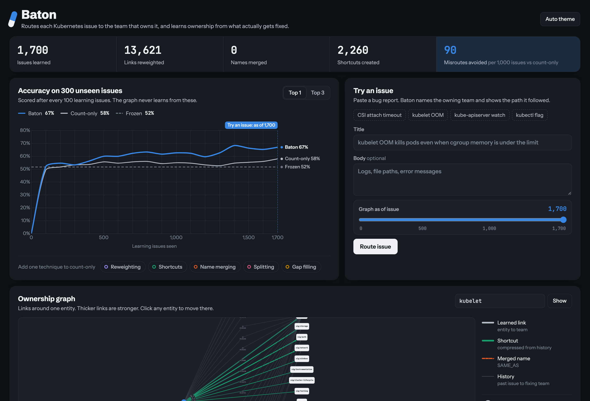

<p align="center">
  
</p>

<h1 align="center">Baton</h1>

**Ownership lists go stale the day they are written. Baton learns ownership from what actually gets fixed.**

<p align="center">
  <a href="https://youtu.be/kw4NBc0R2EY">
    
  </a>
  <br>
  <a href="https://youtu.be/kw4NBc0R2EY">Watch the 1-minute launch video</a>
</p>

Baton routes a new GitHub issue to the team that owns it. It keeps a graph of past issues, the entities in them (components, file paths, words, error phrases, reporters) and the teams that fixed them. Every fixed issue is fed back into the graph: links that predicted the right team get cheaper, links that pointed the wrong way get dearer, and strong patterns become direct shortcuts. The graph lives in [HydraDB](https://github.com/hydra-db/hydradb), and one weighted path query answers "who owns this?".

**Docs:** https://baton-docs-134858271117.us-central1.run.app (plain-language guide to the product, dashboard, agents and results).

There is no AI model in the router. Entity extraction and routing are plain code. An AI agent can sit on top through MCP (see [the agent](#triage-agent-over-mcp)), but the curve below is the plain router.

## The curve


2,000 closed `kubernetes/kubernetes` issues, split by date. The oldest 1,700 are streamed into the graph in order, 100 at a time. The newest 300 are the test set: they are scored after every batch and never learned from. A prediction is right when the top team is one of the issue's `sig/` labels. Stream top-1 is scored the way Baton is used: each of the 1,700 learning issues is routed before its answer is revealed, then learned.

| Line | What it does | Test top-1 | Test top-3 | Stream top-1 | Test top-1 at 0 / 500 / 1,000 / 1,700 |
|---|---|---|---|---|---|
| frozen | graph built once from the first 200 issues, never updated | 0.543 | 0.743 | n/a | 0.543 flat |
| count_only | every issue added, links weighted by raw counts, no learning | 0.593 | 0.783 | 0.615 | 0 / 0.563 / 0.553 / 0.593 |
| reweight | reward and penalise links by outcome | 0.683 | 0.827 | 0.656 | 0 / 0.613 / 0.630 / 0.683 |
| shortcuts | direct entity-to-team links for strong patterns | 0.630 | 0.807 | 0.638 | 0 / 0.583 / 0.583 / 0.630 |
| merging | `SAME_AS` links between entities that always agree | 0.593 | 0.787 | 0.616 | 0 / 0.560 / 0.553 / 0.593 |
| splitting | split an entity whose misses cluster by context | 0.643 | 0.853 | 0.635 | 0 / 0.583 / 0.607 / 0.643 |
| gap_filling | pull older reserve issues for entities the graph knows little about | 0.607 | 0.807 | 0.644 | 0 / 0.567 / 0.580 / 0.607 |
| **baton** | **reweight + shortcuts + gap filling** | **0.700** | **0.860** | **0.700** | 0 / 0.633 / 0.663 / **0.700** |

### With and without the graph

The lines above all run on HydraDB. To check that the graph earns its place, `eval/no_graph.py` runs two classifiers that keep no graph at all, on the same split and the same extracted entities, learned one issue at a time:

| No graph | What it does | Test top-1 | Test top-3 | Stream top-1 |
|---|---|---|---|---|
| lookup | flat entity-to-team counts, score = sum of P(team \| entity) | 0.603 | 0.830 | 0.617 |
| naive Bayes | multinomial naive Bayes with add-one smoothing | 0.703 | 0.867 | 0.645 |

What that shows, honestly:

- **On a fixed test set, Baton ties the best plain-store classifier.** 0.700 against 0.703 top-1 is well inside the noise of 300 issues (about plus or minus 2.6 points).
- **On the live stream, Baton is better.** 0.700 against 0.645 top-1 over 1,700 issues routed before they were learned. Paired on the same issues, Baton alone gets 175 right and naive Bayes alone 82 (McNemar z = 5.8, p < 0.0001). The stream is how a router is used: it has to be right while ownership is still being learned.
- **After an ownership change, Baton relearns faster.** In the simulated reorg below, 500 issues after the change Baton routes 73% of the moved issues right and naive Bayes 39%.
- **Learning on the graph is what makes the difference.** count_only is the same HydraDB graph without learning, and it scores like the flat lookup table (0.593 and 0.603). Baton beats it by **10.7 points of top-1**: **107 fewer misroutes per 1,000 issues**.
- **Every route comes with its reason**: the cheapest path from the issue's entities to the team, which a classifier does not give you.

Issue 0 is the empty graph, so nothing routes there. The graph lines are from the live run against HydraDB (`results/curve.json`). The no-graph lines are in `results/no_graph.json` (`uv run python -m eval.no_graph`).

Route latency during the live curve run, median / p95: baton 179 / 549 ms, count_only 102 / 344 ms, frozen 41 / 90 ms. Baton's graph is bigger (gap filling adds about 900 older issues and 3,770 ROUTES_TO links), so its paths take longer.

### Reproduce it

```sh
uv run python -m eval.run_curve
```

This runs all eight lines live against HydraDB and rewrites `results/curve.json`, the four slider snapshots in `results/snapshots/` and the graph itself (it ends in the baton state at 1,700 issues). To score on the in-memory mirror without HydraDB:

```sh
uv run python -m eval.run_curve --offline
```

That writes `results/curve_offline.json` in about a minute and gives the same scores, line for line. `--lines baton count_only` runs a subset.

## Setup from scratch

macOS, Python 3.10 or newer.

1. **uv and the Python deps**

   ```sh
   curl -LsSf https://astral.sh/uv/install.sh | sh
   uv sync
   ```

2. **Rust through rustup.** HydraDB's `rust-toolchain.toml` pins Rust 1.99.0, and Homebrew's `rustc` is too old.

   ```sh
   curl --proto '=https' --tlsv1.2 -sSf https://sh.rustup.rs | sh
   ```

3. **Build HydraDB** into `~/Projects/hydradb` (or set `BATON_HYDRADB_HOME` to another checkout).

   ```sh
   brew install just cmake pkg-config llvm suite-sparse coreutils
   brew install cleishm/neo4j/libcypher-parser
   git clone https://github.com/hydra-db/hydradb.git ~/Projects/hydradb
   export BINDGEN_EXTRA_CLANG_ARGS="-I$(brew --prefix)/include"
   export LIBRARY_PATH="$(brew --prefix)/lib"
   ```

   The start script sets both exports itself, so they only matter if you run `cargo` by hand.

4. **Start the node.** The first start compiles a release build and takes several minutes. Later starts reuse it.

   ```sh
   scripts/start_hydradb.sh --background
   curl -s 127.0.0.1:8443/healthz
   ```

   It serves bolt on `127.0.0.1:7687` (user `neo4j`, password `local-development-token-32-bytes`, database `default`), logs to `~/Projects/hydradb/.hydradb/node.log`, and stops with `scripts/start_hydradb.sh stop`.

5. **Fill the graph**: `uv run python -m eval.run_curve` (above), or, if `results/snapshots/` is already there, restore the baton end state in seconds:

   ```sh
   uv run python -m eval.restore_graph
   ```

6. **Data (optional).** `data/issues.jsonl` (2,000 issues), `data/reserve.jsonl` (3,000 older reserve issues) and `data/entity_ids.json` are committed, so you do not need to fetch anything. To refetch from GitHub, with a token in `GITHUB_TOKEN` or a logged-in `gh` CLI:

   ```sh
   uv run python -m data.fetch_issues
   ```

Run the tests with `uv run pytest`.

## Dashboard

```sh
uv run uvicorn app.server:app --port 8000
```

Open <http://localhost:8000>.



- **Counters**: issues learned, links reweighted, names merged, shortcuts created and misroutes avoided per 1,000 issues against count-only.
- **Try an issue**: paste a title and body. The slider routes it against the graph as it was at issue 0, 500, 1,000 or 1,700, and shows the top teams, confidence and the path.
- **The curve**, from `results/curve.json`.
- **The graph** around one entity (try `scheduler`).

The API behind it: `POST /route`, `POST /learn`, `GET /curve`, `GET /graph?entity=...`, `GET /stats`. `app/server.py` and the MCP server both call `baton/service.py` and nothing else.

## Use Baton on your repo

Kubernetes is one case study. Baton routes any GitHub repo whose closed issues say who owned them, and [`docs/CASE_STUDIES.md`](docs/CASE_STUDIES.md) has the results on five more. One command onboards a repo end to end:

```sh
gh auth login
uv sync && scripts/start_hydradb.sh
uv run python -m eval.onboard doctor owner/name
uv run python -m eval.onboard onboard owner/name
```

`doctor` samples the newest 1,000 closed issues and scores every owner signal it finds. The signals are a label family such as `sig/`, `T-` or `Component: `, the author of the merged PR that closed the issue (`fixer`), and the assignee. For each one it reports coverage, owners, the largest owner's share and the share of owners already seen earlier, then recommends one. It refuses a repo with one owner (fewer than 2 owners, or one owner with 80% or more of issues) or fewer than about 300 owned closed issues. The reasons are in [`docs/CASE_STUDIES.md`](docs/CASE_STUDIES.md#how-the-doctor-decides). `onboard` runs the doctor, fetches enough owned closed issues for the split, builds the name table, learns the graph in its own HydraDB database and runs every baseline. Override the pick with `--signal fixer` or `--signal label_prefix --prefix area/`. The token comes from `GITHUB_TOKEN` or the `gh` CLI and is never written to disk.

Sizes scale to what the repo has. With 5,000 or more owned closed issues it is the Kubernetes run exactly: 2,000 issues, 1,700 to learn from and 300 held out, 3,000 in reserve, batches of 100. Smaller repos keep the 85/15 split and put the curve's points on batch boundaries.

Then route through any client:

```sh
uv run uvicorn app.server:app --port 8000
curl -s localhost:8000/repos
curl -s localhost:8000/route -H 'content-type: application/json' -d '{"repo": "owner/name", "title": "..."}'
claude mcp add --scope user baton -- uv run --directory "$PWD" python -m agent.mcp_server
```

In Claude Code, ask it to route an issue for `owner/name`, or call `list_repos` first. A repo Baton has not learned gets a 404 (or a tool error) that names the repos it has. A repo the doctor refused gets the doctor's reason.

## Triage agent over MCP

`agent/mcp_server.py` exposes Baton to Claude Code or Codex as six tools. Every tool except `list_repos` takes an optional `repo` (`owner/name`, Kubernetes when omitted):

| Tool | Returns |
|---|---|
| `list_repos()` | The repos Baton has learned, with owner signal, owners and test top-1 |
| `route_issue(title, body, repo)` | Top 3 teams, confidence and path, or a message saying why nothing matched |
| `similar_past_issues(title, body, repo)` | Past issues sharing the most entities, with the fixing team |
| `reporter_history(username, repo)` | Teams that fixed this reporter's earlier issues |
| `team_profile(team, repo)` | Entities most strongly linked to a team |
| `record_outcome(issue, team, repo)` | Feeds the real result back so the graph learns |

The live deployment serves the five read tools over streamable HTTP at `/mcp`, so any client can connect without a checkout:

```sh
claude mcp add --transport http --scope user baton https://baton-134858271117.us-central1.run.app/mcp
```

`record_outcome` writes to the graph, so it is only on the local stdio server. Inside this repo Claude Code also picks that one up from `.mcp.json` (check with `claude mcp list`). Start it with the triage instructions:

```sh
claude --append-system-prompt "$(cat agent/TRIAGE.md)"
```

For Codex, add to `~/.codex/config.toml`:

```toml
[mcp_servers.baton]
command = "uv"
args = ["run", "python", "-m", "agent.mcp_server"]
cwd = "/path/to/baton"
```

`agent/TRIAGE.md` tells the agent to call `route_issue` first, check the other tools when confidence is under 0.6, and answer with one team, the path and the reason. More in [`agent/README.md`](agent/README.md).

## Load test

`eval/loadtest.py` (Locust) hits the API while it learns. 18 users post test-split issues to `/route`, and 2 users post reserve-pool issues to `/learn` at the same time.

```sh
uv run python -m eval.loadtest
```

20 users for 60 seconds on one laptop, against the baton graph at 1,700 issues (`results/loadtest.json`):

| Endpoint | Requests | Failures | Median | p95 |
|---|---|---|---|---|
| `POST /route` | 420 | 0 | 1,700 ms | 4,400 ms |
| `POST /learn` | 33 | 0 | 1,800 ms | 9,000 ms |
| All | 453 | 0 | 1,700 ms | 4,600 ms |

About 7 routes a second with no failures while learning writes ran: 16 of the 33 learn calls were new issues (issues learned went from 1,700 to 1,716), the rest were already in the graph and changed nothing. A single route on its own takes 179 ms median (549 ms p95, from the live curve run), almost all of it inside `algo.MSpaths`, so the queueing under load is the path query. The graph is bigger than in our first load test (2,618 issues against 2,286, because gap filling pulls in more history), and routing under load dropped from about 10 to about 7 a second. The load test changes the graph, so restore it afterwards with `uv run python -m eval.restore_graph`.

## Recovery after a reorg (simulated)


Ownership changes. To show what happens, `eval/recovery.py` pretends that from learning issue 900 on, every `sig/scheduling` issue is fixed by `sig/apps`, and scores the 51 test issues that move. This is a simulation: the real labels never changed, and it runs on the in-memory mirror, not HydraDB.

| Moved-team top-1 | 800 (before) | 900 | 1,100 | 1,300 | 1,400 | 1,500 | 1,700 |
|---|---|---|---|---|---|---|---|
| baton | 0.647 | 0.196 | 0.275 | 0.372 | 0.726 | 0.824 | 0.804 |
| count_only | 0.471 | 0.216 | 0.235 | 0.314 | 0.372 | 0.549 | 0.706 |
| naive Bayes, no graph | 0.569 | 0.196 | 0.235 | 0.333 | 0.392 | 0.529 | 0.824 |
| lookup, no graph | 0.431 | 0.216 | 0.216 | 0.255 | 0.275 | 0.372 | 0.549 |

Every line collapses at the reorg. Baton's penalties push the old links down, so 500 issues later (at 1,400) it is back above its pre-reorg level, while naive Bayes and count_only are still under 40%. Naive Bayes catches up by 1,700, once the new counts outweigh the old ones. Overall top-1 at 1,700: baton 0.713, count_only 0.597. Run it with `uv run python -m eval.recovery` and `uv run python -m eval.no_graph`.

## HydraDB, the graph store

Every route is one weighted `algo.MSpaths` call from the issue's entities to all teams, over outgoing `ROUTES_TO`, `SEEN_IN`, `OWNED_BY` and `SAME_AS` links, with `cost` as the edge weight. From `baton/db.py`:

```python
"CALL algo.MSpaths({"
f"sourceLabel: 'Entity', sourceProperty: 'name', sourceValues: {cypher_strings(sources)}, "
f"targetLabel: 'Team', targetProperty: 'name', targetValues: {cypher_strings(targets)}, "
f"relTypes: {cypher_strings(PATH_REL_TYPES)}, relDirection: 'outgoing', "
f"maxLen: {int(max_len)}, pathCount: {int(path_count)}, pairwise: false, "
f"weightProp: 'cost', resultLimit: {int(result_limit)}"
"}) YIELD path, pathWeight RETURN path, pathWeight"
```

`PATH_REL_TYPES = ("ROUTES_TO", "SEEN_IN", "OWNED_BY", "SAME_AS")`, `maxLen` 3 and `pathCount` 3. Each team's score is the sum of `1 / pathWeight` over its paths, with each path's part divided by the number of teams its source entity reaches, so a generic word that points everywhere counts for less. The cheapest path is the one shown. All links point from entities towards teams (`Entity -ROUTES_TO-> Team`, `Entity -SEEN_IN-> Issue -OWNED_BY-> Team`), so one outgoing search finds every route. Learning writes go back through batched `UNWIND ... MERGE` statements. What we learned about HydraDB while building this is in [`docs/HYDRADB_NOTES.md`](docs/HYDRADB_NOTES.md).

The baton graph at 1,700 issues: 22 teams, 1,257 entities, 2,618 issues, 3,770 `ROUTES_TO`, 20,496 `SEEN_IN` and 3,157 `OWNED_BY` links.

## Honesty notes

- **Sig mentions are hidden.** Many Kubernetes titles say `[sig-node]` or "sig-scheduling" in the text. That would leak the answer, so `HIDE_SIG_MENTIONS = True` in `baton/entities.py` strips them before extraction, for learning and test issues alike. Labels are never used as entities.
- **Tuned on the learning stream only.** Every learning value (reward, penalty, shortcut scale, gap filling thresholds) was picked by `eval/tune_stream.py` on prequential top-1 over the 1,700 learning issues: route each issue before learning it. The test set was never scored during tuning. The search and its scores are in `results/tuning.json`. The scoring rule (dividing each entity's part by the teams it reaches) was also chosen on the stream: it moved stream top-1 from 0.657 to 0.689, and re-tuning gap filling under it gave 0.700. That re-tune lowered test top-1 from 0.710 to 0.700 and we kept it anyway, because picking by test score is not allowed.
- **The shortcut rule differs from the spec.** `docs/SPEC.md` says a shortcut's strength is the number of history paths from the entity to the team. That lets generic words with many issues drown out everything else. Baton uses the share instead: `strength = shortcut_scale * paths / issues_with_entity`, so a shortcut says how much of an entity's history the team owns.
- **Merging and splitting are not in baton.** Both are built and have their own line on the curve. Forward selection on the learning stream, starting from reweight + shortcuts (stream top-1 0.665), kept gap filling (0.700). Adding merging on top dropped it to 0.694 and splitting to 0.692, so neither was added. Splitting has a higher test top-3, and picking by test score was not an option.
- **The plain-store baselines are ours.** Naive Bayes and the lookup table were written for this comparison, on Baton's own entities. A stronger text classifier on raw text might score higher on the fixed test set; we did not try one, because the router has to stay plain code with no model calls.
- **as_of 0 is the empty graph**, so the slider routes nothing there. That is the honest starting point, not a hidden baseline.
- **The recovery demo is simulated** (see above), and the load test ran on one laptop.

## Deploy

One container runs HydraDB and Baton together (`Dockerfile`, `scripts/serve.sh`) and serves the API and dashboard on one port. It runs live at https://baton-134858271117.us-central1.run.app, deployed free to Google Cloud Run with `scripts/deploy_cloud_run.sh <gcp-project-id>` (a spend cap keeps the bill at zero). It also runs locally with `docker compose up`, or on Fly.io with `fly deploy` (about $10 a month for the 2 GB machine HydraDB needs). Details and the other options are in [`docs/DEPLOY.md`](docs/DEPLOY.md). The docs site (`docs-site/`, Fumadocs) deploys as a static site to its own Cloud Run service with `scripts/deploy_docs.sh <gcp-project-id>`.

## Repo layout

```
agent/      MCP server (mcp_server.py), triage instructions (TRIAGE.md)
app/        FastAPI server (server.py) that serves the API, /mcp and the built dashboard from web/dist
baton/      config, models, db (HydraDB driver and MSpaths), entities, ids, dataset,
            ingest, router, learn, passes (merging, splitting, gap filling), snapshots,
            repos (repo profiles), doctor (owner-signal check),
            service (the one interface the API and MCP server call)
data/       fetch_issues.py, fetch_repo.py, issues.jsonl, reserve.jsonl, entity_ids.json,
            repos/<owner>__<name>/ (one profile, issue set and name table per onboarded repo)
docs-site/  documentation site (Fumadocs, static export served by nginx)
docs/       SPEC.md, HYDRADB_NOTES.md, PITCH.md, DEMO.md, CASE_STUDIES.md, presentation/ (pitch deck), assets/
eval/       run_curve, tune_stream, loadtest, restore_graph, recovery, charts, onboard
results/    curve.json, tuning.json, loadtest.json, recovery.json, snapshots/,
            repos/<owner>__<name>/ (curve, baselines, summary and snapshots per repo)
scripts/    start_hydradb.sh
tests/      pytest suite
```

`eval/charts.py` redraws the images in `docs/assets/` from the results files (it needs Google Chrome or Chromium to turn the SVG into PNG): `uv run python -m eval.charts --dashboard http://localhost:8000/`.

## Licence

GPL-3.0. See [LICENSE](LICENSE).
