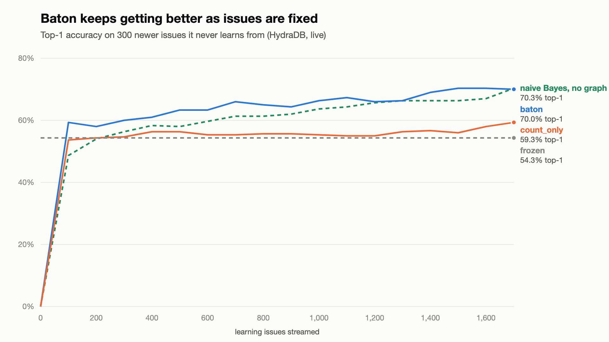
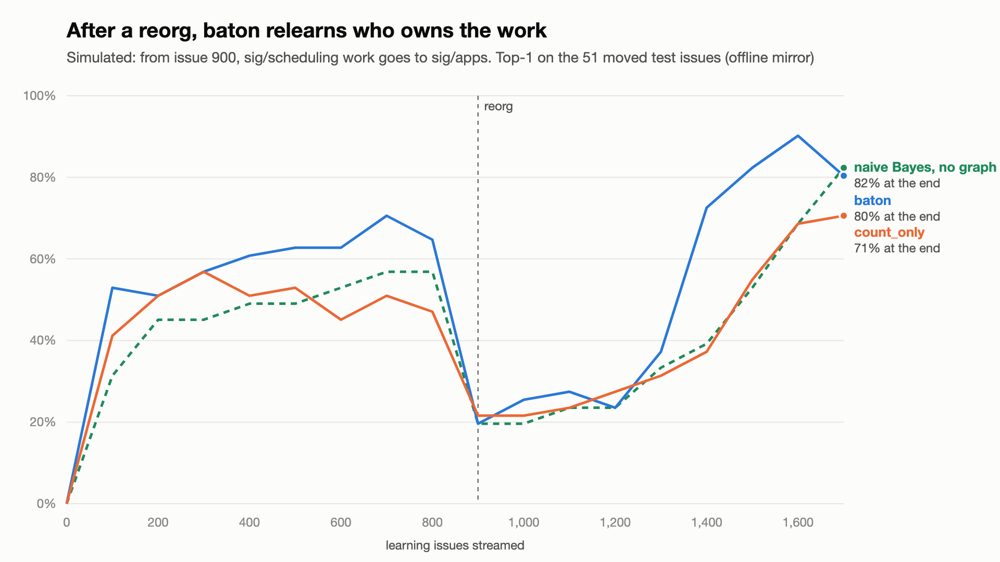

# Baton

**Ownership lists go stale the day they are written. Baton learns ownership from what actually gets fixed.**

Baton routes a new GitHub issue to the team that owns it. It keeps a graph of past issues, the entities in them (components, file paths, words, error phrases, reporters) and the teams that fixed them. Every fixed issue is fed back into the graph: links that predicted the right team get cheaper, links that pointed the wrong way get dearer, and strong patterns become direct shortcuts. The graph lives in [HydraDB](https://github.com/hydra-db/hydradb), and one weighted path query answers "who owns this?".

There is no AI model in the router. Entity extraction and routing are plain code. An AI agent can sit on top through MCP (see [the agent](#triage-agent-over-mcp)), but the curve below is the plain router.

## The curve



2,000 closed `kubernetes/kubernetes` issues, split by date. The oldest 1,700 are streamed into the graph in order, 100 at a time. The newest 300 are the test set: they are scored after every batch and never learned from. A prediction is right when the top team is one of the issue's `sig/` labels.

| Line | What it does | Test top-1 | Test top-3 | Top-1 at 0 / 500 / 1,000 / 1,700 |
|---|---|---|---|---|
| frozen | graph built once from the first 200 issues, never updated | 0.517 | 0.697 | 0.517 flat |
| count_only | every issue added, links weighted by raw counts, no learning | 0.580 | 0.773 | 0 / 0.557 / 0.550 / 0.580 |
| reweight | reward and penalise links by outcome | 0.647 | 0.820 | 0 / 0.577 / 0.617 / 0.647 |
| shortcuts | direct entity-to-team links for strong patterns | 0.613 | 0.800 | 0 / 0.583 / 0.580 / 0.613 |
| merging | `SAME_AS` links between entities that always agree | 0.583 | 0.773 | 0 / 0.557 / 0.557 / 0.583 |
| splitting | split an entity whose misses cluster by context | 0.613 | 0.843 | 0 / 0.547 / 0.563 / 0.613 |
| gap_filling | pull older reserve issues for entities the graph knows little about | 0.613 | 0.790 | 0 / 0.510 / 0.553 / 0.613 |
| **baton** | **reweight + shortcuts + gap filling** | **0.670** | **0.823** | 0 / 0.600 / 0.627 / **0.670** |

Baton beats count_only by **9 points of top-1** and 5 points of top-3: **90 fewer misroutes per 1,000 issues**. Issue 0 is the empty graph, so nothing routes there. All lines are from the live run against HydraDB (`results/curve.json`).

Route latency during the curve run, median / p95: baton 231 / 1,338 ms, count_only 137 / 414 ms, frozen 45 / 93 ms. Baton's graph is bigger (gap filling adds about 1,400 older issues), so its paths take longer.

### Reproduce it

```sh
uv run python -m eval.run_curve
```

This runs all eight lines live against HydraDB and rewrites `results/curve.json`, the four slider snapshots in `results/snapshots/` and the graph itself (it ends in the baton state at 1,700 issues). To score on the in-memory mirror without HydraDB:

```sh
uv run python -m eval.run_curve --offline
```

That writes `results/curve_offline.json` in about a minute and gives the same scores, line for line. `--lines baton count_only` runs a subset.

## Setup from scratch

macOS, Python 3.10 or newer.

1. **uv and the Python deps**

   ```sh
   curl -LsSf https://astral.sh/uv/install.sh | sh
   uv sync
   ```

2. **Rust through rustup.** HydraDB's `rust-toolchain.toml` pins Rust 1.99.0, and Homebrew's `rustc` is too old.

   ```sh
   curl --proto '=https' --tlsv1.2 -sSf https://sh.rustup.rs | sh
   ```

3. **Build HydraDB** into `~/Projects/hydradb` (or set `BATON_HYDRADB_HOME` to another checkout).

   ```sh
   brew install just cmake pkg-config llvm suite-sparse coreutils
   brew install cleishm/neo4j/libcypher-parser
   git clone https://github.com/hydra-db/hydradb.git ~/Projects/hydradb
   export BINDGEN_EXTRA_CLANG_ARGS="-I$(brew --prefix)/include"
   export LIBRARY_PATH="$(brew --prefix)/lib"
   ```

   The start script sets both exports itself, so they only matter if you run `cargo` by hand.

4. **Start the node.** The first start compiles a release build and takes several minutes. Later starts reuse it.

   ```sh
   scripts/start_hydradb.sh --background
   curl -s 127.0.0.1:8443/healthz
   ```

   It serves bolt on `127.0.0.1:7687` (user `neo4j`, password `local-development-token-32-bytes`, database `default`), logs to `~/Projects/hydradb/.hydradb/node.log`, and stops with `scripts/start_hydradb.sh stop`.

5. **Fill the graph**: `uv run python -m eval.run_curve` (above), or, if `results/snapshots/` is already there, restore the baton end state in seconds:

   ```sh
   uv run python -m eval.restore_graph
   ```

6. **Data (optional).** `data/issues.jsonl` (2,000 issues), `data/reserve.jsonl` (3,000 older reserve issues) and `data/entity_ids.json` are committed, so you do not need to fetch anything. To refetch from GitHub, with a token in `GITHUB_TOKEN` or a logged-in `gh` CLI:

   ```sh
   uv run python -m data.fetch_issues
   ```

Run the tests with `uv run pytest`.

## Dashboard

```sh
uv run uvicorn app.server:app --port 8000
```

Open <http://localhost:8000>.


- **Counters**: issues learned, links reweighted, names merged, shortcuts created and misroutes avoided per 1,000 issues against count-only.
- **Try an issue**: paste a title and body. The slider routes it against the graph as it was at issue 0, 500, 1,000 or 1,700, and shows the top teams, confidence and the path.
- **The curve**, from `results/curve.json`.
- **The graph** around one entity (try `scheduler`).

The API behind it: `POST /route`, `POST /learn`, `GET /curve`, `GET /graph?entity=...`, `GET /stats`. `app/server.py` and the MCP server both call `baton/service.py` and nothing else.

## Triage agent over MCP

`agent/mcp_server.py` exposes Baton to Claude Code or Codex as five tools:

| Tool | Returns |
|---|---|
| `route_issue(title, body)` | Top 3 teams, confidence and path |
| `similar_past_issues(title, body)` | Past issues sharing the most entities, with the fixing team |
| `reporter_history(username)` | Teams that fixed this reporter's earlier issues |
| `team_profile(team)` | Entities most strongly linked to a team |
| `record_outcome(issue, team)` | Feeds the real result back so the graph learns |

Claude Code picks the server up from `.mcp.json` in this repo (check with `claude mcp list`). Start it with the triage instructions:

```sh
claude --append-system-prompt "$(cat agent/TRIAGE.md)"
```

For Codex, add to `~/.codex/config.toml`:

```toml
[mcp_servers.baton]
command = "uv"
args = ["run", "python", "-m", "agent.mcp_server"]
cwd = "/path/to/baton"
```

`agent/TRIAGE.md` tells the agent to call `route_issue` first, check the other tools when confidence is under 0.6, and answer with one team, the path and the reason. More in [`agent/README.md`](agent/README.md).

## Load test

`eval/loadtest.py` (Locust) hits the API while it learns. 18 users post test-split issues to `/route`, and 2 users post reserve-pool issues to `/learn` at the same time.

```sh
uv run python -m eval.loadtest
```

20 users for 60 seconds on one laptop, against the baton graph at 1,700 issues (`results/loadtest.json`):

| Endpoint | Requests | Failures | Median | p95 |
|---|---|---|---|---|
| `POST /route` | 592 | 0 | 1,200 ms | 2,700 ms |
| `POST /learn` | 51 | 0 | 1,400 ms | 3,500 ms |
| All | 643 | 0 | 1,200 ms | 2,800 ms |

About 10 routes a second with no failures while learning writes ran: 28 of the 51 learn calls were new issues (issues learned went from 1,700 to 1,728), the rest were already in the graph and changed nothing. A single route on its own takes about 220 ms median (427 ms p95), almost all of it inside `algo.MSpaths`. Entity lookup takes 0.4 ms and scoring in Python 0.1 ms, so the queueing under load is the path query. The load test changes the graph, so restore it afterwards with `uv run python -m eval.restore_graph`.

## Recovery after a reorg (simulated)



Ownership changes. To show what happens, `eval/recovery.py` pretends that from learning issue 900 on, every `sig/scheduling` issue is fixed by `sig/apps`, and scores the 51 test issues that move. This is a simulation: the real labels never changed, and it runs on the in-memory mirror, not HydraDB.

| Moved-team top-1 | 800 (before) | 900 | 1,100 | 1,300 | 1,500 | 1,700 |
|---|---|---|---|---|---|---|
| baton | 0.745 | 0.176 | 0.333 | 0.392 | 0.882 | 0.804 |
| count_only | 0.431 | 0.196 | 0.196 | 0.255 | 0.490 | 0.647 |

Both lines collapse at the reorg. Baton's penalties push the old links down, so it is back above its pre-reorg level 500 issues later. count_only has to outvote the old counts and ends 16 points lower. Overall top-1 at 1,700: baton 0.657, count_only 0.580. Run it with `uv run python -m eval.recovery`.

## HydraDB, the graph store

Every route is one weighted `algo.MSpaths` call from the issue's entities to all teams, over outgoing `ROUTES_TO`, `SEEN_IN`, `OWNED_BY` and `SAME_AS` links, with `cost` as the edge weight. From `baton/db.py`:

```python
"CALL algo.MSpaths({"
f"sourceLabel: 'Entity', sourceProperty: 'name', sourceValues: {cypher_strings(sources)}, "
f"targetLabel: 'Team', targetProperty: 'name', targetValues: {cypher_strings(targets)}, "
f"relTypes: {cypher_strings(PATH_REL_TYPES)}, relDirection: 'outgoing', "
f"maxLen: {int(max_len)}, pathCount: {int(path_count)}, pairwise: false, "
f"weightProp: 'cost', resultLimit: {int(result_limit)}"
"}) YIELD path, pathWeight RETURN path, pathWeight"
```

`PATH_REL_TYPES = ("ROUTES_TO", "SEEN_IN", "OWNED_BY", "SAME_AS")`, `maxLen` 3 and `pathCount` 3. Each team's score is the sum of `1 / pathWeight` over its paths, and the cheapest path is the one shown. All links point from entities towards teams (`Entity -ROUTES_TO-> Team`, `Entity -SEEN_IN-> Issue -OWNED_BY-> Team`), so one outgoing search finds every route. Learning writes go back through batched `UNWIND ... MERGE` statements. What we learned about HydraDB while building this is in [`docs/HYDRADB_NOTES.md`](docs/HYDRADB_NOTES.md).

The baton graph at 1,700 issues: 22 teams, 1,225 entities, 2,286 issues, 3,692 `ROUTES_TO`, 18,032 `SEEN_IN` and 2,767 `OWNED_BY` links.

## Honesty notes

- **Sig mentions are hidden.** Many Kubernetes titles say `[sig-node]` or "sig-scheduling" in the text. That would leak the answer, so `HIDE_SIG_MENTIONS = True` in `baton/entities.py` strips them before extraction, for learning and test issues alike. Labels are never used as entities.
- **Tuned on the learning stream only.** Every learning value (reward, penalty, shortcut scale, gap filling thresholds) was picked by `eval/tune_stream.py` on prequential top-1 over the 1,700 learning issues: route each issue before learning it. The test set was never scored during tuning. The search and its scores are in `results/tuning.json`.
- **The shortcut rule differs from the spec.** `docs/SPEC.md` says a shortcut's strength is the number of history paths from the entity to the team. That lets generic words with many issues drown out everything else. Baton uses the share instead: `strength = shortcut_scale * paths / issues_with_entity`, so a shortcut says how much of an entity's history the team owns.
- **Merging and splitting are not in baton.** Both are built and have their own line on the curve. Forward selection on the learning stream, starting from reweight + shortcuts (stream top-1 0.6465), kept gap filling (0.6571). Adding merging on top dropped it to 0.6553 and splitting gave no gain (0.6571), below the 0.003 bar, so neither was added. Picking by test score was not an option.
- **as_of 0 is the empty graph**, so the slider routes nothing there. That is the honest starting point, not a hidden baseline.
- **The recovery demo is simulated** (see above), and the load test ran on one laptop.

## Repo layout

```
agent/      MCP server (mcp_server.py), triage instructions (TRIAGE.md)
app/        FastAPI server (server.py) and the dashboard (static/index.html)
baton/      config, models, db (HydraDB driver and MSpaths), entities, ids, dataset,
            ingest, router, learn, passes (merging, splitting, gap filling), snapshots,
            service (the one interface the API and MCP server call)
data/       fetch_issues.py, issues.jsonl, reserve.jsonl, entity_ids.json
docs/       SPEC.md, HYDRADB_NOTES.md, PITCH.md, DEMO.md, presentation/ (pitch deck), assets/
eval/       run_curve, tune_stream, loadtest, restore_graph, recovery, charts
results/    curve.json, tuning.json, loadtest.json, recovery.json, snapshots/
scripts/    start_hydradb.sh
tests/      pytest suite
```

`eval/charts.py` redraws the images in `docs/assets/` from the results files (it needs Google Chrome or Chromium to turn the SVG into PNG): `uv run python -m eval.charts --dashboard http://localhost:8000/`.

## Licence

GPL-3.0. See [LICENSE](LICENSE).
